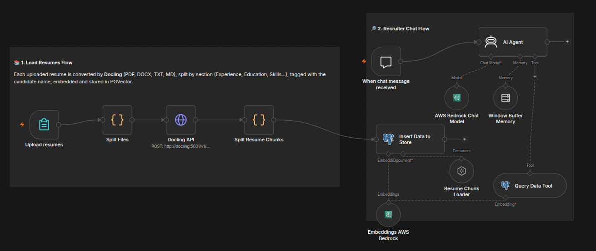
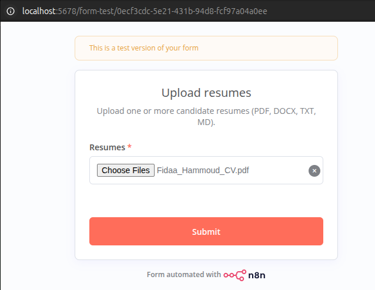
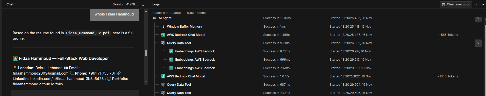

# RAG Embedding System: Resume Search with AWS Bedrock, PGVector & Docling

`resume-rag.json` is an n8n workflow that turns a pile of resumes into a searchable knowledge base and gives you a **recruiting assistant chat**: ask about skills, experience or fit for a role, and it answers only from the resumes, naming the candidate for every claim.

**Stack:** n8n · AWS Bedrock (Claude Sonnet + Titan Text Embeddings v2) · PostgreSQL / pgvector · Docling

> Setup (Docker, credentials, import) is in **[Installation.md](Installation.md)**.



---

## Screenshots

### Upload form (Flow 1)
Recruiters upload one or more resumes through an n8n web form.



### Recruiter chat (Flow 2)
The AI agent searches the vector store (`Query Data Tool`), embeds each query with Titan, and answers from the retrieved resume chunks. The execution log on the right shows each step.



---

## Overview

The workflow contains two independent flows that share one Postgres table (`resumes`) and one embedding model.

```
📚 1. LOAD RESUMES
Upload resumes ─► Split Files ─► Docling API ─► Split Resume Chunks ─► Insert Data to Store ─► PGVector (resumes)
                                                                         ▲            ▲
                                                         Resume Chunk Loader   Embeddings AWS Bedrock
                                                                                      │ (same model)
🔎 2. RECRUITER CHAT                                                                  ▼
When chat message received ─► AI Agent ◄── Query Data Tool (resume_search) ◄── PGVector (resumes)
                                ▲    ▲
               AWS Bedrock Chat Model   Window Buffer Memory
```

| Flow | Trigger | Result |
|---|---|---|
| **Load Resumes** | Web form (file upload) | Each resume is converted, split by section, embedded and stored |
| **Recruiter Chat** | n8n chat | An AI agent searches the resumes and answers your question |

---

## Flow 1: Load Resumes

### 1. Upload resumes (*Form Trigger*)
A web form titled **"Upload resumes"** with one required file field.
- Accepts **`.pdf, .docx, .txt, .md`**
- **Multiple files** per submission
- Each uploaded file arrives as a binary property on a single n8n item.

### 2. Split Files (*Code*)
Turns the single form item into **one item per file**, each with:
- `json.fileName`: the original filename
- `binary.data`: the file itself

This lets the following nodes process each resume independently. It fails with `No files uploaded` if the form was empty.

### 3. Docling API (*HTTP Request*)
`POST http://docling:5001/v1/convert/file` (multipart), once per resume.
- Sends `binary.data` as `files`
- `do_ocr = false` (fast; set to `true` for scanned/image PDFs)
- Timeout: 5 minutes

Docling returns the document as **structured Markdown** (`document.md_content`) with headings, lists and tables preserved, so resume sections like *Experience*, *Education* and *Skills* become Markdown headings.

### 4. Split Resume Chunks (*Code*)
Splits each converted resume into retrieval-friendly chunks:

1. **Error checks:** throws if Docling reports `failure` or returns empty text (usually a scanned PDF).
2. **Candidate name** is derived from the filename: `jane_doe.pdf` becomes `jane doe`, and `John-Smith.docx` becomes `John Smith`.
3. **Section split:** cuts the Markdown at every `#`, `##` or `###` heading and keeps the heading path (e.g. `Jane Doe > Experience`).
4. **Size limit:** sections longer than **1,500 characters** are split further at paragraph boundaries.
5. **Candidate prefix:** every chunk text starts with
   ```
   Candidate: jane doe (file: jane_doe.pdf)
   ```
   so that any chunk retrieved alone still says *whose* resume it is.

Output, one item per chunk:
```json
{
  "text": "Candidate: jane doe (file: jane_doe.pdf)\n\n## Experience\nAcme Corp 2019–2024 ...",
  "metadata": { "filename": "jane_doe.pdf", "candidate": "jane doe", "headings": ["Jane Doe", "Experience"] }
}
```

### 5. Resume Chunk Loader (*Default Data Loader*, sub-node)
Converts each item into a LangChain *Document*:
- **Content** = `text`
- **Metadata** stored alongside the vector:

| Key | Example |
|---|---|
| `source` | `jane_doe.pdf` |
| `candidate` | `jane doe` |
| `section` | `Jane Doe > Experience` |

### 6. Embeddings AWS Bedrock (*sub-node*, shared)
Model **`amazon.titan-embed-text-v2:0`**. Turns text into vectors.
It is connected to **both** the insert node and the query tool, so stored chunks and questions are embedded the same way. Using different models for each would break search.

### 7. Insert Data to Store (*PGVector, insert mode*)
Writes each chunk (text + metadata + embedding) into the Postgres table **`resumes`**. The table is created automatically on first run.
It is kept separate from the generic RAG's `documents` table so resumes and other documents never mix.

---

## Flow 2: Recruiter Chat

### 1. When chat message received (*Chat Trigger*)
Opens n8n's chat interface (**Open chat** button in the editor, or the public URL when the workflow is active). Each message is passed to the AI Agent.

### 2. AI Agent (*Tools Agent*)
The "brain". Up to 20 reasoning/tool steps per question. Its system prompt makes it a **recruiting assistant** that:
- **always searches** before answering, using several searches with different keywords when comparing or ranking candidates
- answers **strictly from the resumes** and never invents skills, dates, employers or contact details
- **names the candidate and file** for every claim
- for role matching, lists each candidate with **matching evidence and gaps**
- if nothing is found, replies *"I couldn't find a matching candidate in the resumes."*

### 3. AWS Bedrock Chat Model (*sub-node*)
Model **`us.anthropic.claude-sonnet-4-6`**, temperature **0.2** (factual, low creativity).

### 4. Query Data Tool (*PGVector, retrieve-as-tool*)
Exposes the `resumes` table to the agent as a tool named **`resume_search`**.
- The agent writes a search query, which is embedded with Titan and compared by similarity against stored chunks.
- Returns the **top 10** most similar chunks (text + metadata).

### 5. Window Buffer Memory (*sub-node*)
Keeps the last **20 messages** of the conversation, so follow-ups like *"and what about her education?"* work.

---

## Example questions

- *Who has more than 5 years of Python experience?*
- *List all candidates with AWS or Kubernetes skills.*
- *Compare the candidates for a Senior Data Engineer role. Who fits best and why?*
- *Summarize John Smith's work history.*
- *Which candidates have a master's degree?*

---

## Tips & limitations

| Topic | Note |
|---|---|
| **File naming** | The candidate name comes from the filename. Use `firstname_lastname.pdf`. |
| **Scanned PDFs** | Fail with "empty content" while OCR is off. Enable `do_ocr` in *Docling API* if needed. |
| **Duplicates** | Re-uploading a resume stores it again. Delete old rows first (see *Maintenance* in [Installation.md](Installation.md)). |
| **Counting / listing everyone** | Search returns the top 10 chunks, so questions like *"list ALL candidates"* over a large pool may be incomplete. |
| **Changing the embedding model** | Empty the `resumes` table and re-ingest everything. |
| **Privacy** | Resumes contain personal data. Text is sent to AWS Bedrock and stored in Postgres, so handle according to your data-protection rules. |

---
